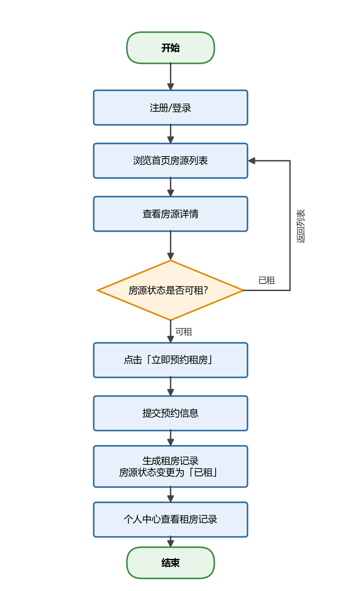
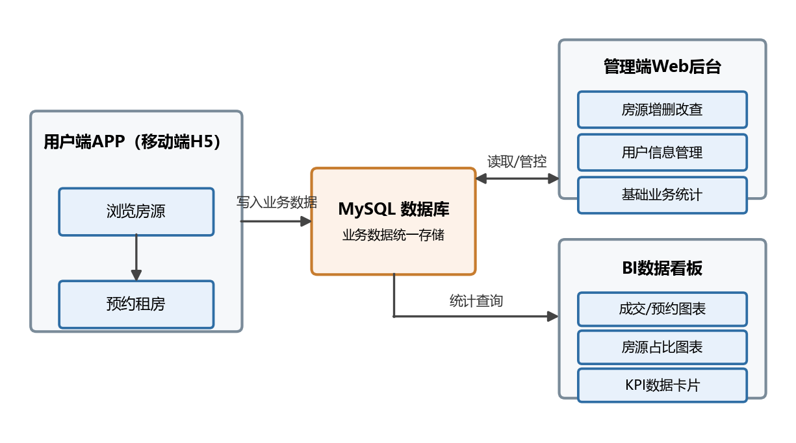
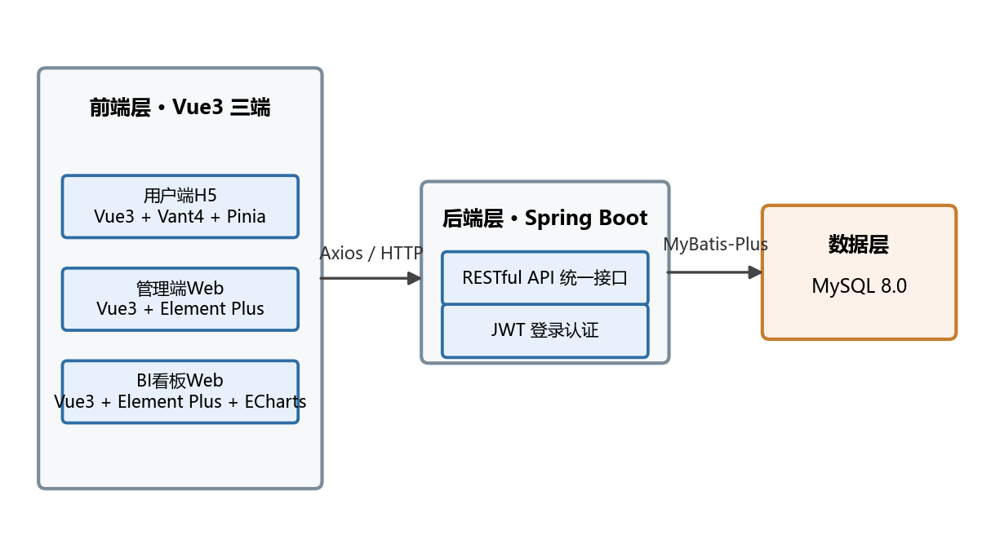

# 公寓租房系统Demo 产品需求文档（PRD）

> 版本：v1.1 ｜ 编写日期：2026-10-09 ｜ 最近更新：2026-10-14 ｜ 文档定位：MVP极简闭环版需求基线

## 一、项目概述

### 1.1 项目背景

本项目为轻量租房业务闭环Demo，实现 **用户操作 → 后台管理 → 数据可视化** 完整业务链路。

### 1.2 三端定位

| 端 | 形态 | 面向角色 | 核心职责 |
| --- | --- | --- | --- |
| **用户端APP** | 移动端H5网页 | 普通租客 | 看房、查价、预约租房、个人中心 |
| **管理端Web** | 桌面端网页 | 运营管理员 | 房源增删改查、用户信息管理、业务数据统计 |
| **BI看板Web** | 桌面端网页 | 管理层 | 可视化图表展示营业额、房源规模与租赁趋势 |

### 1.3 项目亮点

1. 独立设计 **C端用户端 + B端管理端 + 数据可视化端** 完整业务闭环；
2. 实现「用户业务产生数据 → 后台管控数据 → BI可视化分析数据」完整链路；
3. 覆盖房源CRUD、用户管理、业务统计、数据图表监控全套 ToB/ToC 基础功能；
4. 结构清晰、模块解耦，符合企业真实系统架构逻辑。

## 二、三端主要功能

### 2.1 用户端APP（移动端H5）

| 功能ID | 模块 | 功能点 | 功能描述 | 优先级 |
| --- | --- | --- | --- | --- |
| APP-01 | 账号 | 注册/登录 | 账号密码注册（需二次确认密码），昵称默认取账号；JWT保持登录态 | P0 |
| APP-02 | 首页 | 房源列表 | 展示全部公寓房源：图片、户型、面积、租金、状态（可租/已租） | P0 |
| APP-03 | 首页 | 下拉刷新 | 下拉刷新获取最新房源数据 | P0 |
| APP-04 | 首页 | 房源筛选 | 按租金区间、户型、房源状态筛选（可一键过滤已租房源） | P1 |
| APP-05 | 房源详情 | 详情展示 | 价格、户型、配套设施、位置等完整信息 | P0 |
| APP-06 | 房源详情 | 立即预约租房 | 登录用户一键提交租房预约 | P0 |
| APP-07 | 个人中心 | 信息展示 | 展示头像、姓名（未填则显示账号）、账号、电话等基础信息 | P0 |
| APP-08 | 个人中心 | 资料编辑 | 编辑真实姓名、年龄、电话、同住人信息等租房登记资料 | P1 |
| APP-09 | 个人中心 | 我的租房记录 | 查看本人历史预约/租房记录列表 | P0 |
| APP-10 | 个人中心 | 取消预约 | 对「已预约」记录二次确认后取消，取消后释放房源 | P1 |

### 2.2 管理端Web（B端运营）

| 功能ID | 模块 | 功能点 | 功能描述 | 优先级 |
| --- | --- | --- | --- | --- |
| ADMIN-01 | 房源管理 | 新增房源 | 录入房源图片、户型、面积、租金、配套设施、位置等信息 | P0 |
| ADMIN-02 | 房源管理 | 编辑房源 | 修改房源价格、户型、状态、图片等 | P0 |
| ADMIN-03 | 房源管理 | 删除房源 | 删除无效房源 | P0 |
| ADMIN-04 | 房源管理 | 列表与筛选 | 查看全部房源列表，筛选可租/已租房源 | P0 |
| ADMIN-05 | 用户管理 | 用户列表 | 查看所有注册用户信息 | P0 |
| ADMIN-06 | 用户管理 | 租房记录查看 | 查看指定用户的租房/预约记录 | P1 |
| ADMIN-07 | 用户管理 | 用户数量统计 | 统计注册用户总数 | P1 |
| ADMIN-08 | 用户管理 | 删除用户 | 删除不再使用的账号，级联清理其租房记录并释放占用的房源 | P1 |
| ADMIN-09 | 业务统计 | 预约量统计 | 今日/本周预约量（不含已取消记录） | P1 |
| ADMIN-10 | 业务统计 | 房源概览 | 房源总数、已租数量、空置数量 | P0 |
| ADMIN-11 | 业务统计 | 统计下钻 | 统计卡片可点击：用户/房源类跳转对应列表并带筛选，预约量类弹出明细列表 | P1 |

### 2.3 BI数据看板（数据监控）

| 功能ID | 模块 | 功能点 | 功能描述 | 实现方式 | 优先级 |
| --- | --- | --- | --- | --- | --- |
| BI-01 | KPI卡片 | 核心数据卡片 | 总房源数、当月营业额（含当日营业额与环比上月）、待租房源数 | 数字卡片组件 | P0 |
| BI-02 | 图表 | 月度营业额对比图 | 近 6 个月营业额柱状对比，当月高亮，可直观对比本月与上月 | ECharts 柱状图 | P0 |
| BI-03 | 图表 | 房源占比饼图 | 已租/空置房源占比，中心显示总套数 | ECharts 饼图 | P0 |
| BI-04 | 图表 | 每日营业额柱状图 | 展示近 7 天每日营业额分布 | ECharts 柱状图 | P0 |
| BI-05 | 图表 | 数据自动刷新 | 定时刷新统计数据 | 定时任务 | P2（预留） |

**营业额口径说明**：Demo 无支付与订单模块，营业额按「该时段内未取消预约记录所对应房源的月租金合计」计算；若房源租金后续被管理员修改，历史营业额会随之变化，属 Demo 简化。

## 三、业务逻辑流程图

### 3.1 整体业务流程闭环

1. 用户在APP浏览房源、查看价格、提交租房预约；
2. 所有数据同步至后台数据库；
3. 管理员在Web后台管理房源、查看用户信息、统计业务数据；
4. BI系统自动统计数据，以图表形式展示营业额、房源与租赁趋势。

### 3.2 用户租房主流程



### 3.3 三端数据闭环图



**闭环说明**：APP产生业务数据（浏览、预约、订单）→ Web后台管控业务数据（改价、上下架、管理用户）→ BI看板分析业务数据（营业额、房源规模与占比）。

## 四、技术架构

### 4.1 总体架构

采用**前后端分离**架构：三端前端共用一套 Vue3 技术体系，通过 RESTful API 对接统一的 Spring Boot 后端，数据存储于 MySQL。

### 4.2 前端技术栈（三端统一 Vue框架）

| 类别 | 选型 | 版本 | 说明 |
| --- | --- | --- | --- |
| 构建工具 | Vite | 5.x | 快速冷启动与热更新 |
| 核心框架 | Vue | 3.x（Composition API） | 三端统一框架 |
| 路由 | Vue Router | 4.x | SPA页面路由 |
| 状态管理 | Pinia | 2.x | 登录态等全局状态 |
| HTTP请求 | Axios | 1.x | 统一封装、请求/响应拦截器 |
| 用户端UI | Vant | 4.x | 移动端H5组件库 |
| 管理端/BI UI | Element Plus | 2.x | 桌面端组件库 |
| 图表库 | ECharts | 5.x | BI看板图表渲染 |

### 4.3 后端技术栈

| 类别 | 选型 | 版本 | 说明 |
| --- | --- | --- | --- |
| 语言/框架 | Spring Boot | 3.x（JDK 17） | 主流企业级后端框架，生态成熟 |
| ORM框架 | MyBatis-Plus | 3.5.x | 简化CRUD、SQL可控 |
| 数据库 | MySQL | 8.0 | 关系型数据存储 |
| 认证 | JWT | — | 无状态登录态 |
| 参数校验 | spring-boot-starter-validation | — | 接口入参校验 |
| 接口文档 | Knife4j | 4.x | 在线API文档与调试 |

**选型理由**：Spring Boot + MySQL 为课程与中小企业项目最主流组合，学习资料丰富、部署简单；MyBatis-Plus 让房源/用户 CRUD 开发效率高；前后端分离使三端可共享同一套后端API，符合"模块解耦"的项目亮点。

### 4.4 整体技术架构图



### 4.5 工程目录结构规划

```text
rental-apartment/
├── rental-app/        # 用户端H5：Vue3 + Vant4（移动端）
├── rental-admin/      # 管理端Web：Vue3 + Element Plus
├── rental-bi/         # BI看板Web：Vue3 + Element Plus + ECharts
└── rental-server/     # 后端服务：Spring Boot 3 + MyBatis-Plus
```

## 五、数据库关键表

> PRD粒度概览，详细字段以数据库设计文档为准。

### 5.1 用户表（user）

| 字段 | 说明 |
| --- | --- |
| id | 用户ID（主键） |
| username / password | 账号 / 密码（加密存储） |
| nickname | 昵称（注册时默认等于账号，不支持单独修改） |
| real_name / age | 真实姓名 / 年龄 |
| phone / cohabitants | 联系电话 / 同住人信息 |
| avatar | 头像URL |
| create_time | 注册时间 |

### 5.2 房源表（apartment）

| 字段 | 说明 |
| --- | --- |
| id | 房源ID（主键） |
| title / images | 标题 / 房源图片 |
| layout / area | 户型 / 面积（㎡） |
| rent | 月租金（元） |
| status | 状态：可租 / 已租 |
| facilities | 配套设施 |
| address | 位置信息 |
| create_time / update_time | 创建 / 更新时间 |

### 5.3 租房记录表（booking）

| 字段 | 说明 |
| --- | --- |
| id | 记录ID（主键） |
| user_id | 预约用户ID（外键） |
| apartment_id | 房源ID（外键） |
| status | 记录状态：已预约 / 已成交 / 已取消 |
| create_time | 预约时间 |

**Demo简化原则**：提交预约即生成记录并同步更新房源状态为「已租」，不涉及支付与审核环节；`status` 字段保留扩展能力，便于后续演进。

**取消规则**：仅「已预约」记录可由本人取消，取消后状态置为「已取消」；若该房源下已无其他「已预约」记录，房源状态同步恢复为「可租」（避免误释放他人占用的房源）。「已取消」记录不参与预约量统计。
